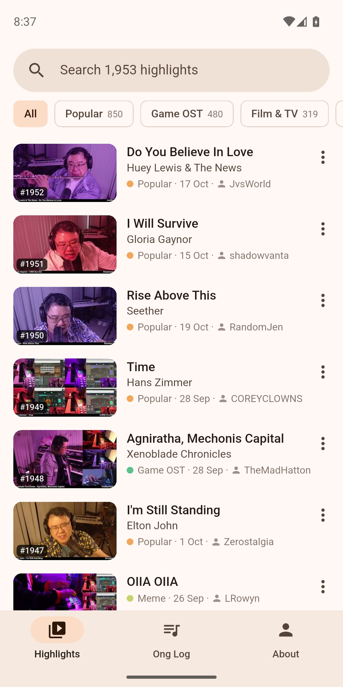
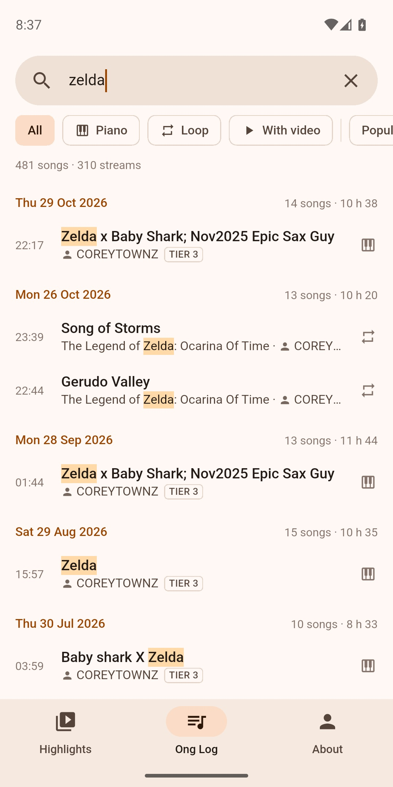
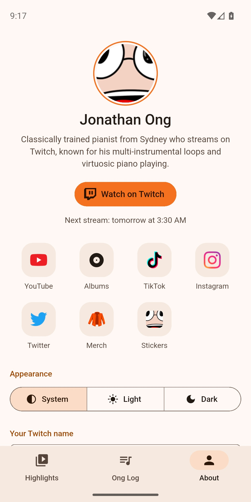

# Ong Music

Experience the musical genius of Jonathan Ong, anytime, anywhere!

**Category**: Music & Entertainment

## [▶ Open the web app](./)

Works in any browser, and it is the way to use Ong Music on **iPhone and iPad**. To install it:
open [the web app](./) in **Safari**, tap **Share** (on recent iOS versions it is behind the More or menu button
next to the address), then **Add to Home Screen** (under **View More** if it is not listed). The page shows the steps
for the Safari it runs in.

Also available on [Google Play](https://play.google.com/store/apps/details?id=nbros.ong_music) (Android)
and as a [Windows download](https://github.com/nbros/ong_music/releases/latest).

| Highlights          | Ong Log search      | About             |
| ------------------- | ------------------- | ----------------- |
|  |  |  | 

Please read the [Privacy Policy](privacy-policy.md) (TLDR: this app doesn't collect any personal information)
